<p align="center"></p>

# Kijkbord installeren op Proxmox

Kijkbord is een bord voor thuis, op je tv of een tablet aan de muur: de klok, het weer, regen de komende twee uur,
de agenda, afval en verjaardagen. Kijkbord zit in een **gesloten test**. Deze repository bevat alleen het
installatiescript; de code zelf is nog privé. Meedoen? Meld je aan via
[agtenhosting.com/tools/kijkbord](https://agtenhosting.com/tools/kijkbord/).

## Installeren

Open de shell van je Proxmox-host (als root) en voer uit:

```bash
bash -c "$(curl -fsSL https://raw.githubusercontent.com/sagten88/kijkbord-installer/main/install.sh)"
```

Het script:

1. vraagt een paar dingen (containernummer, opslag, geheugen, netwerk), met standaardwaarden;
2. maakt een Debian 13-container (1 kern, 512 MB, 4 GB);
3. maakt een sleutel waarmee deze server de code mag **lezen**. **Stuur die sleutel naar de beheerder**;
   zodra die hem heeft toegevoegd, druk je op Enter en gaat de installatie verder;
4. installeert Node.js en alleen een versie met een geldige handtekening van de beheerder;
5. stelt automatische updates in en toont het adres en de **installatiecode**.

## Na de installatie

- Open het adres dat het script toont (poort 3100) en kies met de installatiecode een wachtwoord voor de beheerder.
- Vul bij **Instellingen** je adres, agenda's, afval en verjaardagen in.
- Op de tv of tablet: open de schermlink uit **Instellingen > Schermen**. Dat scherm blijft daarna gekoppeld.
- Kijkbord werkt alleen op je **thuisnetwerk**.
- **Updates** gaan elke nacht vanzelf. Uitzetten of zelf bijwerken kan bij **Instellingen > Updates**, of in de
  container met `kijkbord-update install`.

## Gemaakt met Claude

Kijkbord en dit script zijn gebouwd met [Claude](https://claude.com/product/claude-code), de AI van Anthropic.
Agten Hosting bepaalt wat er gebouwd wordt, test het, en ondertekent en publiceert elke versie.

Licentie: [AGPL-3.0-or-later](LICENSE). Copyright © 2026 Agten Hosting.
